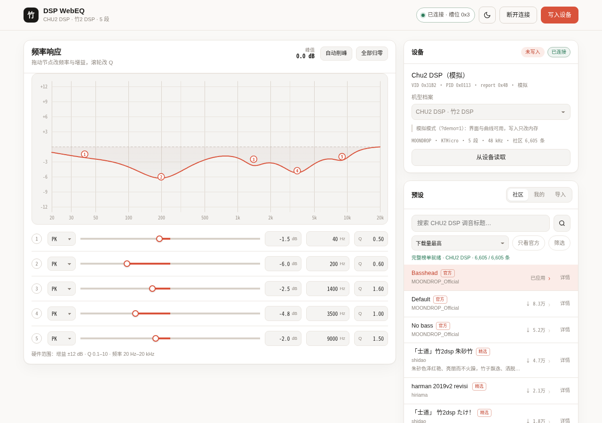

<div align="center">

# DSP WebEQ

**A browser-based hardware PEQ editor for the Moondrop CHU II DSP**

[](https://moon.closure.asia)
[](LICENSE)
[](webapp/README.md#protocol)
[](webapp/README.md#支持的机型--supported-devices)

[Live](https://moon.closure.asia) · [Quick start](#-quick-start) · [Supported devices](#-supported-devices) · [Deployment](#-deployment) · [Technical docs](webapp/README.md) · [中文](README.md)



</div>

---

The browser talks to the USB DAC over **WebHID**: no driver, no backend, a pure static page. Built for the Moondrop **CHU II DSP**, with support for other dongles that use the KTMicro protocol and the Moondrop SPV family (Rays, FreeDSP, DAWN PRO2, ...).

## ✨ Features

- **Curve editing**: 5 / 8 / 10 band PEQ, draggable nodes, precise gain / frequency / Q entry, automatic headroom
- **Community presets**: per-model browsing, sorted by downloads, title / tag / official-only filters; details with band table and curve preview
- **Import / export**: local presets, JSON, and EqualizerAPO / AutoEq text import
- **Experience**: light / dark themes (follows the system, choice remembered), HID command log
- **Zero dependencies**: a single HTML file or a static directory, hostable on any static server

## 🎧 Supported devices

27 profiles in total: 11 KTMicro and 16 SPV. Detection uses the product name first, then VID/PID.

| Family | Example models | Status |
| --- | --- | --- |
| CHU II DSP | Chu2 DSP (`0x31B2` / `0x0113`) | ✅ Verified on hardware |
| KTMicro dongles | Kiwi Ears series, TANCHJIM ONE / BUNNY, etc. | ✅ Verified / confirmed configs |
| SPV family (`0x0666`) | Rays, FreeDSP, DAWN PRO2, etc. | ⚠️ Experimental, not tested on hardware |

> The full 27-profile table with per-profile verification status is in the [technical docs](webapp/README.md#支持的机型--supported-devices).

## 🚀 Quick start

```bash
cd webapp
./run.sh
```

Open <http://localhost:8099/> in Chrome or Edge. Add `?demo=1` to look at the UI without a device.

- WebHID only exists in a **secure context**: `localhost` works, `http://192.168.x.x` and `http://100.x.x.x` do not. For remote use, deploy behind HTTPS — see [deployment](#-deployment).
- After connecting, the current curve is read from the device. "写入设备" (Write to device) is the single write path. A commit restarts the device for about a second and stores the curve; uncommitted changes are lost on unplug.

## 🌐 Deployment

The page is a static site. The repo ships Caddy / Nginx / Docker Compose configs — see [`webapp/deploy/DEPLOY.md`](webapp/deploy/DEPLOY.md). For Tailscale setups, see [`webapp/serve.sh`](webapp/serve.sh).

Live instance: <https://moon.closure.asia>

## ⚠️ Disclaimer

This is an **unofficial** project, not affiliated with, authorized by, or endorsed by MOONDROP or its affiliates.

The tool changes EQ parameters on the device over HID and saves them to flash. A write can overwrite the existing tuning, restart the device, or produce unexpected sound. **SPV-family writes have not been verified on physical hardware.** Use at your own risk; the full text is in the [technical docs · disclaimer](webapp/README.md#disclaimer).

## 📄 License

[MIT](LICENSE). Register maps, the community API, and notes on adding new models are in [`webapp/README.md`](webapp/README.md).
