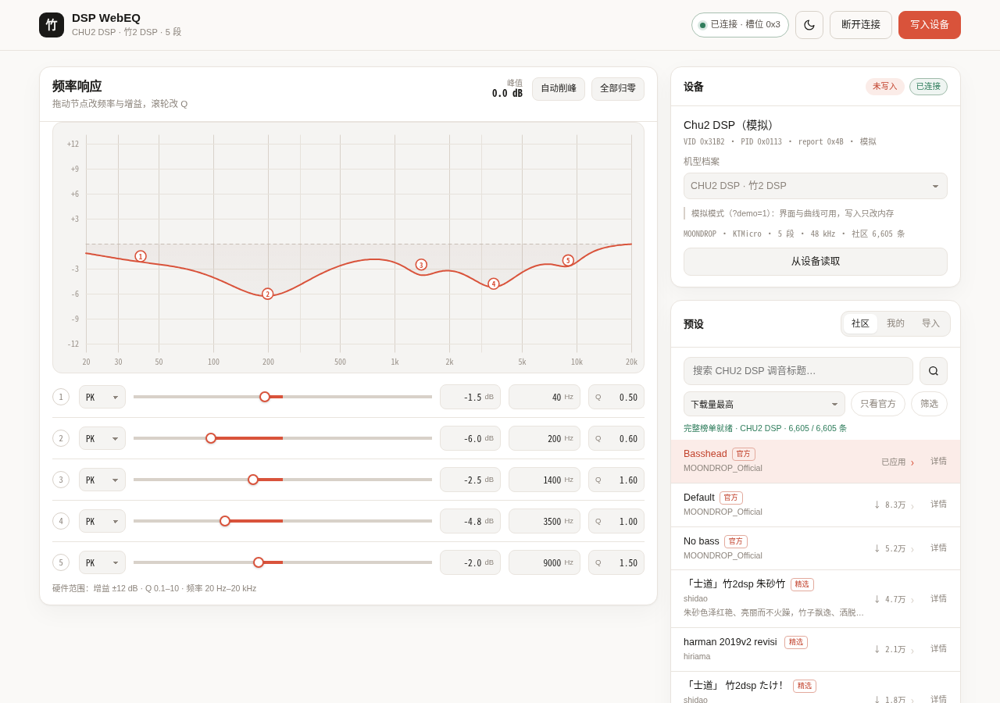

<div align="center">

# DSP WebEQ

**网页版水月雨 CHU II DSP 硬件 PEQ 编辑器**

*A browser-based hardware PEQ editor for the Moondrop CHU II DSP*

[](https://moon.closure.asia)
[](LICENSE)
[](webapp/README.md#协议--protocol)
[](webapp/README.md#支持的机型--supported-devices)

[在线使用](https://moon.closure.asia) · [快速开始](#-快速开始) · [支持机型](#-支持机型) · [部署](#-部署) · [技术文档](webapp/README.md) · [English](README.en.md)



</div>

---

浏览器通过 **WebHID** 直接读写 USB 声卡里的硬件 PEQ：不装驱动、没有后端，纯静态页面。面向水月雨 **CHU II DSP**，同一套代码也支持采用 KTMicro 报文的其他小尾巴，以及水月雨 SPV 家族（Rays、FreeDSP、DAWN PRO2 等）。

## ✨ 功能

- **曲线编辑**：5 / 8 / 10 段 PEQ，节点可拖拽，增益、频率、Q 支持精确输入，自动削峰
- **社区预设**：按机型浏览，下载量排序，标题 / 标签 / 官方筛选；详情页含频段表与曲线预览
- **导入导出**：本地预设、JSON，以及 EqualizerAPO / AutoEq 文本导入
- **体验**：日 / 夜主题（跟随系统，可记忆选择）、HID 指令日志
- **零依赖**：单 HTML 或纯静态目录，任何静态服务器都能托管

## 🎧 支持机型

共 27 个机型档案：KTMicro 家族 11 个、SPV 家族 16 个。设备识别先看产品名、再看 VID/PID。

| 家族 | 代表机型 | 状态 |
| --- | --- | --- |
| CHU II DSP | 竹2 DSP（`0x31B2` / `0x0113`） | ✅ 真机验证 |
| KTMicro 小尾巴 | Kiwi Ears 系列、TANCHJIM ONE / BUNNY 等 | ✅ 真机验证 / 官方配置 |
| SPV 家族（`0x0666`） | Rays、FreeDSP、DAWN PRO2 等 | ⚠️ 实验，未真机验证 |

> 完整档案表与逐项验证状态见[技术文档 · 支持的机型](webapp/README.md#支持的机型--supported-devices)。

## 🚀 快速开始

```bash
cd webapp
./run.sh
```

用 Chrome 或 Edge 打开 <http://localhost:8099/>。没有设备时可以先加 `?demo=1` 看界面。

- WebHID 只在**安全上下文**可用：`localhost` 可以，`http://192.168.x.x`、`http://100.x.x.x` 不行。远程使用请部署到 HTTPS，见[部署](#-部署)。
- 连接后自动读取设备当前曲线；「写入设备」是唯一写入口。提交后设备重启约一秒，曲线落盘，未提交的修改拔插即丢。

## 🌐 部署

页面是纯静态文件，仓库内置 Caddy / Nginx / Docker Compose 配置，详见 [`webapp/deploy/DEPLOY.md`](webapp/deploy/DEPLOY.md)；Tailscale 场景可用 [`webapp/serve.sh`](webapp/serve.sh)。

线上实例：<https://moon.closure.asia>

## ⚠️ 免责声明

本项目**非官方**，与水月雨（MOONDROP）及其关联公司无关，未获授权或背书。

工具会通过 HID 修改声卡里的 EQ 参数并写入 flash：可能覆盖原有调音、让设备重启或发出异常声音；**SPV 家族的写入未在真机上验证**。使用风险自负，完整说明见[技术文档 · 免责声明](webapp/README.md#disclaimer)。

## 📄 许可证

[MIT](LICENSE)。协议字节表、社区接口、机型接入等完整技术说明见 [`webapp/README.md`](webapp/README.md)。
