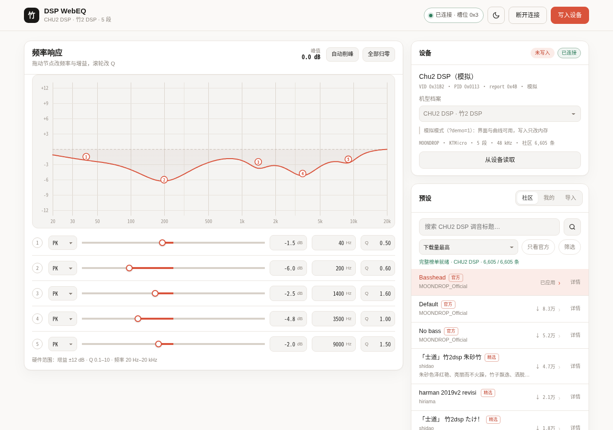

# 竹二 DSP WebEQ / CHU II DSP WebEQ

[中文](#中文) · [English](#english)

  



## 中文

这个网页工具调的是水月雨 CHU II DSP（竹2 DSP）的硬件 PEQ。浏览器通过 WebHID 直接读写 USB 声卡，不装驱动，也没有后端。

同一套代码也能用在采用 KTMicro 报文的其他小尾巴，以及水月雨 SPV 家族（Rays、FreeDSP、DAWN PRO2 等）。竹2 和 KTMicro 家族的寄存器布局有真机抓包或 devicePEQ 的已确认配置作依据；SPV 家族的报文是从官方 APK 里反编译出来的，读取、写入、保存都已实现，但我没有在实物上验证过，所以标为实验。

机型表里现在有 27 个档案，KTMicro 11 个、SPV 16 个；每个档案的验证状态在下面的表里。

> 非官方项目，与水月雨没有关系。写入会改变设备里的 EQ 状态，风险自负。完整说明见[免责声明](#disclaimer)。

### 快速开始

```bash
cd webapp
./run.sh
```

用 Chrome 或 Edge 打开 <http://localhost:8099/>。没有设备时可以加 `?demo=1` 先看界面。

WebHID 只在安全上下文里可用。`localhost` 可以，`http://192.168.x.x` 和 `http://100.x.x.x` 不行，这两种地址下 `navigator.hid` 是 `undefined`。

连接后会自动读取设备曲线。如果编辑器里已经有未保存的曲线（比如刚从社区载入一条），连接不会覆盖它；要设备原值就点「从设备读取」。调完点右上角「写入设备」，提交后设备重启，音频断大约一秒，重新连上即可继续。

社区、我的、导入都在右侧同一张卡片里。点社区一行只会把曲线放进编辑器，写入仍然走右上角那一个按钮。社区默认按下载量排序，第一次打开某个机型会抓一次完整榜单，之后按机型缓存 12 小时。每条预设右侧有「详情」，可以看作者写的描述、频段表和曲线预览。右上角的月亮/太阳按钮切换日间和夜间，第一次打开跟随系统，手动切过之后会记住。

要在另一台电脑上打开也可以。页面和 HID 都在打开页面的那台机器上，把站点放到 HTTPS 域名，设备仍然接在你自己的电脑上。仓库里的 `serve.sh` 是 Tailscale 的示例，实际域名换成你的。

Windows 上如果 Chrome 看不到设备：换 Edge；先插耳机再开浏览器；换一个 USB 口，不要用 Hub；还不行就换 Linux 或 macOS。KTMicro 的 HID 枚举在 Windows 上偶尔会漏掉 Consumer Control 集合。

### 功能

- 5 / 8 / 10 段 PEQ，曲线节点可拖，增益、频率、Q 可以精确输入
- 峰值读数；设备没有可用的预增益，超过 0 dB 可以用「自动削峰」把整条曲线下移
- 社区列表按机型切换，默认下载量排序，支持标题、标签、最低下载量、只看官方
- 预设详情：完整描述、作者/下载/日期/类型/标签、频段表、当前机型上的曲线预览
- 本地预设、JSON 导入导出、EqualizerAPO / AutoEq 文本导入
- 日 / 夜主题，以及 HID 指令日志

### 已知限制

- SPV 家族的写入没有在真机上验证。先读取再写，最好和官方 App 对比一次。
- 竹2 的预增益寄存器能写能读，但没有听觉效果，整体电平只能靠各段自己让。
- 提交会重启设备。一次只存一套曲线，没有多槽位切换的验证。
- Echo-BP（32 段）、Old Fashioned（另一套寄存器协议）和 FreeDSP 9 段（synopsys）不在支持范围。
- 官方 App 里 108 个产品并不都能写硬件 EQ。有线型号的 EQ 只是软件曲线，TWS / 蓝牙型号走各自的芯片协议，只有 USB DSP 小尾巴有可写的片上 PEQ。
- 不在机型表里的 `0x0666` 设备会直接拒绝，不会盲写。

## English

This is a browser-based hardware PEQ editor for the Moondrop CHU II DSP (Chu2 DSP). It talks to the USB DAC over WebHID. There is no driver, installer, or backend.

The same code covers other dongles that use the KTMicro protocol and the Moondrop SPV family (Rays, FreeDSP, DAWN PRO2, ...). The Chu2 and KTMicro register maps are backed by device captures and devicePEQ's confirmed configurations. The SPV protocol was reverse-engineered from the official APK. Reading, writing, and saving are implemented, but I have not tested it on physical hardware; those profiles are marked experimental.

There are 27 profiles: 11 KTMicro and 16 SPV. The verification status for each one is in the table below.

> Unofficial project. Not affiliated with Moondrop. Writing changes the EQ state on the device; use at your own risk. See the [disclaimer](#disclaimer).

### Quick start

```bash
cd webapp
./run.sh
```

Open <http://localhost:8099/> in Chrome or Edge. Add `?demo=1` if you want to look at the UI without a device.

WebHID only exists in a secure context. `localhost` works. `http://192.168.x.x` and `http://100.x.x.x` do not; `navigator.hid` is `undefined` there.

After connecting, the app reads the current curve from the device. If the editor already holds an unsaved curve, for example one just loaded from the community list, connecting will not overwrite it. Use "从设备读取" when you want the device value. "写入设备" is the only write path. A commit restarts the device, audio drops for about a second, and you can reconnect after that.

The community, local preset, and import tabs live in one card. Clicking a community row only loads it into the editor; writing still goes through the single button in the top bar. The community list is sorted by downloads by default. The first visit for a model fetches the full list and caches it per model for 12 hours. The "详情" button opens the author's description, the band table, and a curve preview. The moon/sun button switches light and dark themes; the first visit follows the system setting, and a manual choice is remembered.

To open the editor from another computer, put the static site behind a valid HTTPS domain. The page and the HID access both happen on the machine that has the device plugged in. `serve.sh` is a Tailscale example; replace the host name with your own.

On Windows, if Chrome cannot see the device: try Edge, plug the dongle in before opening the browser, use a direct USB port instead of a hub, or move to Linux/macOS. KTMicro HID enumeration occasionally misses the Consumer Control collection on Windows.

### Features

- 5, 8, or 10 bands, draggable response curve, precise gain/frequency/Q entry
- Peak readout and automatic headroom; the device has no usable pre-gain
- Community list scoped to the current model, sorted by downloads, with title, tag, minimum-download, and official-only filters
- Preset details: full description, author/downloads/date/type/tags, band table, curve preview for the current model
- Local presets, JSON import/export, EqualizerAPO / AutoEq text import
- Light/dark theme and a HID command log

### Known limitations

- SPV writes have not been tested on physical hardware. Read the current curve first, and compare with the official app once.
- The Chu2 pre-gain register reads and writes, but has no audible effect. Overall level has to come from the individual bands.
- A commit restarts the device. There is one curve slot and no verified slot switching.
- Echo-BP (32 bands), Old Fashioned (a different register protocol), and the 9-band FreeDSP (synopsys) are not supported.
- Most of the 108 products in the official app do not expose writable hardware EQ. Wired models use software curves, TWS/Bluetooth models use their own chip protocols, and only USB DSP dongles have on-chip PEQ.
- An unrecognized `0x0666` device is refused instead of being written with a guess.

## 支持的机型 / Supported devices

识别顺序是产品名优先，再看 VID/PID。竹二和 Kiwi KT_0211L 共用 PID `0x0113`，靠产品名区分。认不出名字但 VID 是 `0x31B2` 时落到通用档案；不在表里的 `0x0666` 设备直接拒绝。

Detection uses the product name first, then VID/PID. The Chu2 and Kiwi KT_0211L share PID `0x0113` and are separated by name. An unknown `0x31B2` device falls back to the generic profile; an unlisted `0x0666` device is refused.

| 档案 / Profile | 总线 / Bus | 状态 / Status |
| --- | --- | --- |
| CHU2 DSP · 竹2 DSP | KTMicro `0x31B2` / `0x0113` | 已验证 / Verified |
| Kiwi Ears Chorus (KT_1132L) | KTMicro | 已验证，band4 Q 在 `0x3F` / Verified, band4 Q at `0x3F` |
| Kiwi Ears S-Link (KT_3016L) | KTMicro | 已验证，5 段寄存器乱序 / Verified, out-of-order registers |
| TANCHJIM ONE / BUNNY / FISSION | KTMicro, base `0x26` | 配置来自 devicePEQ，未在本机验证 / Confirmed config, not tested here |
| Kiwi Ears Allegro PRO / Mini, KT_0211L | KTMicro, base `0x26` | 同上 / Same |
| JCally KT02H20 | KTMicro, `compensate2X` | 实验，频率读 ×2 / 写 ÷2，仅 PK / Experimental, frequency ×2, PK only |
| MOONDROP CDSP | KTMicro, base `0x26` | 同一套报文，未在本机验证 / Same protocol, not tested here |
| KT0210 / KT02xx generic | KTMicro | 手动兜底 / Manual fallback |
| Rays, AG Rays, X AG Rays, FreeDSP Mini/Pro, DAWN PRO2, Marigold, DHA15, E.S. combo, MM3A, Deco, MOONRIVER 3, Position, BLUE ROSE, ddHiFi Memory | SPV `0x0666`, 8 bands | 实验 / Experimental |
| GM01 Pro | SPV `0x0666`, 10 bands | 实验 / Experimental |

SPV 设备按产品名和 `0x0666` 识别，`peqIndex` 随机型不同：多数是 7，E.S. combo 是 4，MM3A 是 63，GM01 Pro 是 99。加新机型是在 `js/devices.js` 里加一个对象；`writeAck: false` 表示芯片不回单段写 ACK，`freqScale: 2` 表示频率要补偿 2×。

SPV devices are matched by product name and `0x0666`. `peqIndex` differs per model: 7 for most, 4 for E.S. combo, 63 for MM3A, 99 for GM01 Pro. To add a model, add an object to `js/devices.js`. `writeAck: false` means the chip does not ACK individual register writes; `freqScale: 2` compensates the stored frequency.

## 协议 / Protocol

### KTMicro（竹2 / KT0210 家族）

竹2 是复合 USB 设备：UAC1 音频在 interface 0，调音通道是 interface 3 的 HID。

The Chu2 is a composite USB device. UAC1 audio is interface 0; the tuning channel is the HID interface 3.

| 项 / Item | 值 / Value |
| --- | --- |
| VID / PID | `0x31B2` / `0x0113` |
| 产品串 / Product string | `Chu2 DSP` |
| HID usage page | `0xFF01` (vendor) |
| 报文 / Report | report ID `0x4B` + 10-byte payload, interrupt OUT `0x03` / IN `0x83` |
| 芯片 / Chip | KTMicro KT0210 class |

```text
byte:  0     1  2  3  4     5  6  7  8  9
      reg   00 00 00 cmd   00  v0 v1 v2 v3
cmd:  0x52 'R' read  0x57 'W' write  0x53 'S' commit  0x43 'C' clear
```

| 寄存器 / Register | 含义 / Meaning | 值 / Value |
| --- | --- | --- |
| `0x24` | EQ 槽位 / EQ slot | `0x03` custom/on, `0x02` off |
| `0x26 + 2i` | 第 i 段 / band i | gain ×10 (int16 LE) + frequency Hz (uint16 LE) |
| `0x27 + 2i` | 第 i 段 / band i | Q ×1000 (uint16 LE) + type (`0` PK / `3` LS / `4` HS) |
| `0x66` | 预增益 / pre-gain | readable and writable, no audible effect on the Chu2 |

写入流程：读 `0x24`，如果是 `0x02` 先写 `0x03`，逐段写增益/频率和 Q/类型，然后发提交 `00 00 00 00 53 00 00 00 00 00`。设备重启约一秒，曲线才落盘。不提交的修改拔插后丢失。

The write flow reads `0x24`, switches it to `0x03` if it is `0x02`, writes each band's gain/frequency and Q/type, then sends the commit packet `00 00 00 00 53 00 00 00 00 00`. The device restarts for about a second before the curve is stored. Uncommitted changes are lost on unplug.

寄存器布局、字节序和提交包与 `jcharvet/chu2-studio` 的 `docs/PROTOCOL.md`、`jeromeof/devicePEQ` 的 `ktmicroUsbHidHandler.js` 以及一份真机抓包对照过。

The register layout, byte order, and commit packet were cross-checked against `jcharvet/chu2-studio` (`docs/PROTOCOL.md`), `jeromeof/devicePEQ` (`ktmicroUsbHidHandler.js`), and a device capture.

### SPV（水月雨 0x0666 家族）

协议来自 APK 反编译。相关代码在 `classes.dex` 的 `ns4` / `UsbDeviceHandler`，原生部分在 `libutils-lib.so` 的 `SpvCodecNative` 和 `IIRFilterCalculator`。

The protocol comes from decompiling the APK: `ns4` / `UsbDeviceHandler` in `classes.dex`, and `SpvCodecNative` / `IIRFilterCalculator` in `libutils-lib.so`.

```text
packet: [0x4B, OP, CMD, LEN, payload...]     LEN = total - 4

write:  OP=1, CMD=9, payload length 33
        [0]=0 [1]=band [2..3]=0 [4..23]=20-byte coefficients
        [24..25]=frequency LE [26..27]=Q Q8.8 [28..29]=gain Q8.8
        [30]=type [31]=0 [32]=peqIndex

enable: OP=1, CMD=10, payload [0, 0, 255, 255]
save:   OP=1, CMD=1
```

- 系数是 5 个 int32 LE，Q30 定点，采样率 96 kHz。
- Q 和增益是 Q8.8（×256）。
- 类型：LS=1，PK=2，HS=3，LP=4，HP=5。
- 读取用 `OP=0x80, CMD=9`，payload 是 `[0, band]`，返回的频率、Q、增益、类型在 offset 27 开始。
- 写入顺序是逐段写、使能全部系数、保存 flash；按官方 App 的实现，SPV 保存后不重启。

- Coefficients are five int32 LE values in Q30 at 96 kHz.
- Q and gain are Q8.8 (×256).
- Filter types: LS=1, PK=2, HS=3, LP=4, HP=5.
- Reads use `OP=0x80, CMD=9` with payload `[0, band]`; frequency, Q, gain, and type start at offset 27.
- Writes go band by band, enable all coefficients, then save to flash. In the official app, SPV devices do not restart after a save.

## 社区接口 / Community API

接口是公开 GET，不需要 token，`access-control-allow-origin: *`，网页里可以直接 fetch。

The API is public GET, needs no token, and returns `access-control-allow-origin: *`, so the page can fetch it directly.

```bash
# 列表按 productUuid 查询 / list by productUuid
curl "https://cdn-service.moondroplab.tech/api/v1/peq-configs/all?productUuid=6772a0d5-3f1c-4567-967a-210e61be2308&pageIndex=1&pageSize=30"

# 标题搜索 / 只看官方
...&title=bass
...&type=OFFICIAL

# 单条详情：desc / createTime / source 等 / single detail
curl "https://cdn-service.moondroplab.tech/api/v1/peq-configs/<uuid>"

# 预设文件，列表里的 file 字段 / preset file
curl "https://cdn.moondroplab.tech/peq-config-file/AhBJ2Z53tkioiXjh-Fe2d.txt"
```

列表里的常用字段是 `title`、`username`、`downloadcount`、`tags[]`、`newTags[]`、`file`、`type`（`OFFICIAL` / `USER` / `PRIVATE`）和 `isFeatured`。预设文件是数组，每项包含 `frequency`、`q`、`gain` 和 `filter`；社区数据里的 `filter` 目前几乎都是 `0`（PK）。

The list items expose `title`, `username`, `downloadcount`, `tags[]`, `newTags[]`, `file`, `type` (`OFFICIAL` / `USER` / `PRIVATE`), and `isFeatured`. A preset file is an array of `frequency`, `q`, `gain`, and `filter` objects. In the current community data, `filter` is almost always `0` (PK).

每个机型用各自的 `productUuid`。榜单默认按下载量排序；接口本身不接受排序参数，所以排序在浏览器里做。第一次打开某个机型会按 1000 条/页抓取完整清单（竹2 约 7 页，FreeDSP 系列约 18 页），之后按机型缓存 12 小时。切回「最新发布」时走服务端分页。

Each model has its own `productUuid`. The ranking is sorted by downloads in the browser because the API does not accept sort parameters. The first visit for a model fetches the full list at 1000 items per page (about 7 pages for the Chu2 and 18 for the FreeDSP family), then caches it per model for 12 hours. Switching back to "最新发布" uses server-side pagination.

写这份文档时，竹2 约 6,600 条，Rays/AG Rays 约 8,800 条，FreeDSP 系列约 17,300 条，CDSP 约 1,200 条。数字会随着上传变化。

At the time of writing: about 6,600 presets for the Chu2, 8,800 for Rays/AG Rays, 17,300 for the FreeDSP family, and 1,200 for CDSP. These numbers change as people upload presets.

按下载量排出来的竹2 头部 / Top downloaded Chu2 presets（写这份文档时 / at the time of writing）：

```text
120,618×  Basshead
 82,466×  Default
 52,430×  No bass
 47,252×  「士道」竹2dsp 朱砂竹
 20,843×  harman 2019v2
```

列表里的 `score`、`like`、`dislike` 目前都是 0，服务端没有在计算，所以没有真实的“热度”可以排。界面里也没有编一个假的热度分。

`score`, `like`, and `dislike` are currently all 0; the server does not calculate them. There is no real popularity score to sort by, and the UI does not invent one.

## 文件结构 / Layout

```text
webapp/
  index.html        markup
  styles.css        layout, light/dark theme
  run.sh            local static server
  build-single.py   build the single-file HTML
  chu2-webeq.html   generated single-file build
  test-hidraw.py    Linux: read the device without a browser
  serve.sh          Tailscale /eq example
  enable-tailnet.sh one-off Tailscale serve helper
  deploy/           nginx, Caddy, Docker, verification script
  js/
    protocol.js     WebHID transport, KTMicro, SPV, mock device
    eqmath.js       RBJ biquad, response, peak/headroom
    chart.js        curve rendering and node dragging
    community.js    community API and preset conversion
    importers.js    link/uuid/JSON/AutoEq parsing
    devices.js      device profiles and register maps
    app.js          state, UI, import/export
```

单文件版用 `./build-single.py` 生成，CSS 和 JS 全部内联。`python3 test-hidraw.py` 可以在 Linux 上绕过浏览器读取当前曲线，只读，不写。

Run `./build-single.py` to generate the single-file build with CSS and JS inlined. On Linux, `python3 test-hidraw.py` reads the current curve without a browser; it does not write.

## 验证 / Verification

截至 2026-11。As of November 2026.

| 项 / Item | 状态 / Status |
| --- | --- |
| KTMicro 寄存器 / 字节序 / 提交包 | 与两份社区实现和一份真机抓包逐字节对照 / Byte-for-byte checked against two community implementations and a device capture |
| SPV 组包与系数 | APK 反编译确认；多组滤波的系数与官方 hub 的 JS 实现逐字节对照 / Confirmed from the APK; coefficients checked byte for byte against the official hub JS for representative filters |
| 读写流程 | 假 HID 设备跑通 8 段读取 → 写入 → 使能 → 保存 / Fake HID device: 8-band read, write, enable, save |
| UI | Chromium 桌面与移动端，360/390/768/1280 宽度，无横向溢出，无脚本报错 / Chromium desktop and mobile, 360/390/768/1280, no horizontal overflow or script errors |
| 真实设备 HID 收发 | **没有在实物上跑过**。第一次用先「从设备读取」 / **Not tested on physical hardware.** Read the device before writing |

<a id="disclaimer"></a>
## 免责声明 / Disclaimer

**中文**

这是一个非官方项目，与水月雨（MOONDROP）及其关联公司没有关系，也没有获得授权或背书。

工具会通过 HID 直接修改声卡里的 EQ 参数并写入 flash。写入可能改变或丢失设备里原有的调音，可能让设备重启或发出异常声音；SPV 家族的写入还没有在真机上验证。请在能接受这些风险的前提下使用，写入前先用「从设备读取」保存原始曲线。

社区调音和产品数据的版权归原作者及水月雨所有，本项目只做读取和格式转换。软件按 MIT 许可提供，不对设备损坏、数据丢失或听感变化承担任何责任。

**English**

This is an unofficial project. It is not affiliated with, authorized by, or endorsed by MOONDROP or its affiliates.

The tool writes EQ parameters to the device over HID and saves them to flash. A write can change or lose the existing tuning, restart the device, or produce unexpected sound. SPV-family writes have not been verified on physical hardware. Use the tool at your own risk, and read the current curve from the device before writing.

Community presets and product data belong to their authors and MOONDROP. This project only reads and converts them. The software is provided under the MIT license, without warranty of any kind; the authors are not liable for device damage, data loss, or changes in sound.

## 参考 / References

- [`jcharvet/chu2-studio`](https://github.com/jcharvet/chu2-studio) — CHU 2 DSP protocol notes and a Windows implementation
- [`jeromeof/devicePEQ`](https://github.com/jeromeof/devicePEQ) — KTMicro WebHID implementation and device captures
- 官方社区接口 `cdn-service.moondroplab.tech` 与资源 CDN `cdn.moondroplab.tech`

## License

MIT. See [`LICENSE`](LICENSE).
